# code2petri — Grand Roadmap to Unity/Unreal Analysis

### Current State (Tickets 01–50 Complete — Phases 1, 2, 2.5, 2.6, 2.7 & 2.8 Delivered)

We have a fully working, multi-language `code2petri` CLI and Python package that:
- Parses **Python (`.py`)** and **JavaScript (`.js`)** source files, targeting individual functions, methods, callbacks, or global scripts.
- Implements a formal `WalkerProtocol` (`abc.ABC`) returning `WalkResult(net, call_sites)` with `CallSite` inventory records.
- Composes shared graph-building and state-management infrastructure via `ControlFlowBuilder` (counters, try/loop context stacks, `wire_sequential_statement`, `wire_if_split`, `wire_try_catch`, `wire_standard_loop`, `wire_terminal_exception`).
- Decouples AST traversal and statement dispatch via `StatementContext` parameter objects and safe property extractors, eliminating Feature Envy and Message Chains.
- Translates the full spectrum of control-flow structures in both languages: sequential statements, `if/elif/else`, `while`, `for` (including JS `for..in`/`for..of`), `do..while`, `switch/case/default`, `try/catch/finally` (and Python `try/except/else/finally`), `break`, `continue`, `return`, `raise`/`throw`, and function calls.
- Provides cross-language parity for synthetic `(global)` execution scope, allowing top-level script code to be targeted and visualized as standalone Petri nets.
- Supports qualified function targeting for class methods (`ClassName.methodName`) and synthetic addressing for anonymous arrow/callback functions (`(anonymous@line)`).
- Detects `requestAnimationFrame` game-loop recursion patterns and maps them to Petri net back-arcs from terminal execution states to the function start place.
- Performs **Cross-File Reference Tracing (Phase 2)**:
  - Harvests constructor variable bindings (`x = Foo()` / `const x = new Foo()`) per [ADR 0001: Constructor-Only Variable Resolution](file:///Volumes/SharedDrive/Documents/GitHub/code2flow/docs/adr/0001-constructor-only-variable-resolution.md).
  - Indexes context files in a dedicated `SymbolTable`, resolving qualified method calls (`gpuEngine.step()` → `WebGLEngine.step`) and bare function calls while enforcing same-language boundaries.
  - Ingests `--context` file paths or recursive directories with platform-safe filtering (`._*` AppleDouble skip).
  - Serializes call resolutions across formats: PNML `<toolspecific>` XML tags (`<resolved>` / `<unresolved>`), Graphviz DOT (`tooltip` and color coding: `#2e7d32` for resolved, `#e65100` for unresolved), and JSON (`resolved`, `resolved_to`, `target_file`, and root `"status": "[unresolved]"`).
- Computes **Structural Folding & Structuredness Metric (SM)** (Phase 2.5):
  - Greedy bottom-up reduction engine (`code2petri/fold.py`) implementing Lassen & van der Aalst (2008) Definitions 17–23.
  - Recursively accumulates transition complexity weights $\tau$ and penalizes components ($\omega$) across Sequence, Choice, Loop, Marked-Graph, and Unstructured structures.
  - Generates JSON fold-step snapshots for progressive playback and analysis.
- Performs **Inline Expansion** (`code2petri/inline.py`):
  - Splices callee Petri net subgraphs into caller nets at call transitions with bipartite graph boundary place unification ([ADR 0002](file:///Volumes/SharedDrive/Documents/GitHub/code2flow/docs/adr/0002-boundary-place-unification.md)).
  - Guarded against infinite recursion cycles with `--inline-depth`.
- Features **ProM Local Reduction Port & Interactive Compound Subnet Expansion** (Phase 2.6):
  - Ports Java ProM local reduction algorithms ([ADR 0003](file:///Volumes/SharedDrive/Documents/GitHub/code2flow/docs/adr/0003-adopt-prom-local-reduction-algorithm.md)): Single-Place Contraction ($1 \to 1 \to 1$), Atomic Choice Collapse (1.5x symmetry multiplier), and bidirectional SESE reachability, naturally normalizing AST branch routing places without spurious unstructured penalties.
  - Resolves nested call sites inside inlined callee subnets against the `SymbolTable`, coloring them green (`#2e7d32`).
  - Self-contained, offline Cytoscape.js HTML viewer (`code2petri/viewer/template.html`): embeds pre-computed callee net payloads (`callee_nets_json`), enabling interactive client-side compound subnet expansion on resolved calls with boundary place rewiring and Dagre animation.
- Delivers **Live Fold Reduction & Interactive Composite Viewer** (Phase 2.7):
  - Boots into a fully-expanded composite view on load, rendering all inlined functions nested inside visual compound nodes (`enclosing_function` / `parent` hierarchy).
  - Implements the complete suite of ProM & Lassen reduction rules directly in JavaScript: Place-Centric Live Fold (Single-Place Contraction for Sequence, Choice Reduction with branch symmetry multiplier, While Loop), plus macro SESE contractions (Marked Graph, State Machine, Well-Structured SESE, and Unstructured Knot isolation).
  - Automates **Collapsed Compound State**: when all internal nodes of an inlined function are reduced to a single component, the container automatically transitions into a compact tile labeled `function_name (c_XX)`.
  - Implements non-linear **Component-Local Unfold**: right-clicking any opaque transition or collapsed compound instantly restores the exact subgraph and boundary arcs consumed without disturbing folds elsewhere.
  - Initially featured a **Floating HUD Popover** for component inspection and renaming; Phase 2.8 replaces it with a docked inspector sidebar while retaining component renaming.
  - Implements **Client-Side Export**: downloads the current on-screen canvas state as standard ISO/IEC 15909-2 compliant PNML without server roundtrips, ready for direct analysis in tools like ProM.
  - Preserves zoom and pan through folds and unfolds, keeps the folded component at the selected place's screen position, and supports zooming out to 0.1% for very large nets (Tickets 43–44).
  - Modularized frontend architecture: extracted `code2petri/viewer/engine/reduction_engine.js` (2,500 lines) and `pnml_exporter.js` (236 lines), eliminating ~3,000 lines of inlined JS from `template.html`.
- Delivers **Interactive Viewer Enhancements** (Phase 2.8):
  - Replaces the floating inspector with a docked right sidebar that pushes the canvas and provides a stable home for inspection and reduction actions ([ADR 0004](../../docs/adr/0004-docked-sidebar-instead-of-floating-popover.md)).
  - Supports box selection and one-pass Batch Place Fold, plus repeated Fold Entire Function passes scoped to a selected compound.
  - Saves and opens versioned Fold State Snapshots offline, restoring graph and restoration records, engine state, document identity, layout, and viewport.
  - Displays the active root function alongside the source file; the label continues to describe the root document when a callee is inspected.
- Outputs PNML (ISO/IEC 15909 compliant XML), Graphviz DOT, JSON, PNG, SVG, and interactive self-contained offline HTML.
- Automated coverage includes **over 400 unit, integration, and cross-file validation tests**, including headless viewer DOM, prototype, and session-resumption coverage; the real-world multi-file target is [GameOfLife_Simulator](file:///Users/pingchungtsai/My%20Drive%20%28ric6121824%40gmail.com%29/Digital%20Media%20MSc/Semester%204/GameOfLife_Simulator).
- Completed the Phase 2.8 review through Round 3 with no blocking standards or specification findings; Round 3 recorded one optional low-priority result-shape cleanup suggestion.

## End Goal

Run `code2petri` against an entire **Unity (C#)** or **Unreal Engine (C++)** project and produce:
1. **Per-function Petri nets** for any function in the project
2. **Cross-file composite nets** that trace calls across file boundaries
3. **Engine-aware lifecycle overlays** that model the implicit execution order imposed by the game engine (MonoBehaviour lifecycle, Actor tick/BeginPlay, event dispatchers)
4. **Interactive HTML viewer** with Lassen & van der Aalst structural folding, SM score computation, and interactive multi-level compound expansion

### Primary Validation Target

**[GameOfLife_Simulator](file:///Users/pingchungtsai/My%20Drive%20%28ric6121824%40gmail.com%29/Digital%20Media%20MSc/Semester%204/GameOfLife_Simulator)** — a 2-file JavaScript project:
- [app.js](file:///Users/pingchungtsai/My%20Drive%20%28ric6121824%40gmail.com%29/Digital%20Media%20MSc/Semester%204/GameOfLife_Simulator/app.js) (182 lines): global functions (`init`, `loop`, `stepCpu`, `countNeighbors`, etc.) + event listeners
- [webgl-engine.js](file:///Users/pingchungtsai/My%20Drive%20%28ric6121824%40gmail.com%29/Digital%20Media%20MSc/Semester%204/GameOfLife_Simulator/webgl-engine.js) (216 lines): `WebGLEngine` class with methods (`step`, `randomize`, `drawToScreen`, etc.)

This project exercises: global-scope code, class methods, cross-file calls (`app.js` → `WebGLEngine`), and the `requestAnimationFrame` game-loop pattern.

---

## Phased Roadmap

```mermaid
graph LR
    P1["Phase 1 ✅\nJS Walker +\nAbstraction Layer"] --> P2["Phase 2 ✅\nCross-File\nReference Tracing"]
    P2 --> P25["Phase 2.5 ✅\nFolding Engine,\nSM Metric & Viewer"]
    P25 --> P26["Phase 2.6 ✅\nProM Port & Interactive\nCompound Expansion"]
    P26 --> P27["Phase 2.7 ✅\nLive Fold Reduction,\nLocal Unfold & Export"]
    P27 --> P28["Phase 2.8 ✅\nViewer Interaction &\nSession Continuity"]
    P28 --> P29["Phase 2.9\nCompact & Reliable\nSession Saves"]
    P29 --> P210["Phase 2.10\nFunction Return\nMetadata"]
    P210 --> P3["Phase 3\nC# Walker +\nUnity Lifecycle"]
    P210 --> P4["Phase 4\nC++ Walker +\nUnreal Lifecycle"]
    P3 --> P5["Phase 5\nProject-Scale\nComposite Nets"]
    P4 --> P5
    P5 --> P6["Phase 6 — Future\nColoured Petri Nets\nGame State Modeling"]
    style P1 fill:#2d6a2d,color:#fff
    style P2 fill:#2d6a2d,color:#fff
    style P25 fill:#2d6a2d,color:#fff
    style P26 fill:#2d6a2d,color:#fff
    style P27 fill:#2d6a2d,color:#fff
    style P28 fill:#2d6a2d,color:#fff
    style P6 stroke-dasharray: 5 5
```



---

## Phase 1 — Walker Abstraction & JavaScript Support (Completed — Tickets 07–10, Round 8)

### Why JavaScript first (not C#/C++)

> [!IMPORTANT]
> JavaScript was chosen as the **cheapest proving ground** for multi-language architecture. code2flow already ships an Acorn-based JS parser ([javascript.py](file:///Volumes/SharedDrive/Documents/GitHub/code2flow/code2flow/javascript.py)), so we reused its `get_tree()`. JS has `if/else`, `while`, `for`, `try/catch/finally`, `return`, `switch`, `do..while` — covering and expanding upon the constructs handled in Python.
>
> Additionally, the [GameOfLife_Simulator](file:///Users/pingchungtsai/My%20Drive%20%28ric6121824%40gmail.com%29/Digital%20Media%20MSc/Semester%204/GameOfLife_Simulator) is the primary validation target, so JS support was needed immediately.

### Design Decisions & Implementation Reality

| Decision | Planned Resolution | Final Implementation Reality (Tickets 07–10) |
|---|---|---|
| **Walker Architecture** | Static method protocol | `WalkerProtocol` defined as an `abc.ABC` with instance methods (`parse_file`, `find_function`, `find_all_functions`, `walk_function`, `get_node_lineno`). CLI dynamically routes by extension via `WALKERS[ext]()`. |
| **Composition over Inheritance** | Abstract base class hierarchy | `ControlFlowBuilder` encapsulates Petri net counters, stacks (`loop_stack`, `try_stack`), and wiring primitives (`wire_sequential_statement`, `wire_if_split`, `wire_try_catch`, `wire_standard_loop`, `wire_terminal_exception`). Walkers compose `ControlFlowBuilder` rather than inheriting from a base walker class, preventing subclass coupling and Refused Bequest. |
| **Traversal Decoupling** | Direct AST walking | `StatementContext` parameter object passed across statement dispatch handlers; `get_nested` helper extracts nested AST properties safely, eliminating Feature Envy and Message Chains. |
| **Global-scope code** | Synthetic `(global)` wrapper in JS | Synthetic `(global)` execution scope implemented with parity across **both** `JavascriptWalker` and `PythonWalker`, allowing top-level script statements to be targeted via `--target-function='(global)'`. |
| **Discoverable functions** | Declarations & methods | `FunctionDeclaration`, class methods (qualified as `ClassName.methodName`), named arrow functions / function expressions, and synthetic callback identifiers. |
| **Anonymous callbacks** | Excluded from targeting | Discoverable via `--list-functions` and targetable via parenthetical syntax `ParentFunction.(anonymous@LineNumber)` (e.g., `(anonymous@151)` or `init.(anonymous@42)`). |
| **`requestAnimationFrame(loop)`** | Back-arc cycle | Recursive `requestAnimationFrame` calls where the argument matches the enclosing function name produce back-arcs from terminal execution states to the function start place, faithfully representing game-loop recursion. |
| **Transition Labels** | AST unparsing | Python unparses AST expressions; JavaScript slices raw source text via Acorn byte offsets (`start`/`end`), preserving exact formatting and avoiding AST unparsing fidelity loss. |

### Implemented Tickets (Phase 1 Breakdown)

#### Ticket 07: Walker Protocol & Shared Infrastructure
- Defined [`code2petri/walker_protocol.py`](file:///Volumes/SharedDrive/Documents/GitHub/code2flow/code2petri/walker_protocol.py) with runtime-enforced `WalkerProtocol(abc.ABC)`.
- Created [`code2petri/control_flow_builder.py`](file:///Volumes/SharedDrive/Documents/GitHub/code2flow/code2petri/control_flow_builder.py) containing `ControlFlowBuilder` (counters, loop/try stacks, arc management, higher-level wiring primitives).
- Refactored `PythonWalker` to implement `WalkerProtocol` and compose `ControlFlowBuilder`.
- Updated Python function discovery to output qualified class method names (`ClassName.methodName`).
- Extracted shared graph assertions into [`tests/petri_assertions.py`](file:///Volumes/SharedDrive/Documents/GitHub/code2flow/tests/petri_assertions.py).

#### Ticket 08: JavaScript Walker Skeleton & Sequential Statements
- Implemented [`code2petri/javascript_walker.py`](file:///Volumes/SharedDrive/Documents/GitHub/code2flow/code2petri/javascript_walker.py) consuming Acorn JSON AST from `code2flow.javascript.Javascript.get_tree()`.
- Implemented source text caching and byte-offset slicing for precise transition labels.
- Added top-level statement harvesting and synthetic `(global)` wrapper execution.
- Implemented sequential statement chains, return statement routing to terminal places, and opaque function call transitions.
- Added initial JavaScript unit test suite in [`tests/test_javascript_walker.py`](file:///Volumes/SharedDrive/Documents/GitHub/code2flow/tests/test_javascript_walker.py).

#### Ticket 09: JavaScript Core Control Flow
- Implemented `if / else if / else` branching (XOR-split at condition transition, recursive branch walking, single merge place).
- Implemented `while`, `for`, `for..in`, and `for..of` loops as cycles (loop head place, body transition, back-arc, exit transition).
- Implemented `break` (jump to enclosing loop exit place) and `continue` (jump to loop head place).
- Implemented `try / catch / finally` with exception arcs from try body transitions to catch entry, and convergence into mandatory finally blocks.

#### Ticket 10: JavaScript Specifics & Game-Loop Translation
- Implemented `switch / case / default` as XOR-splits with support for empty case fallthrough.
- Implemented `do...while` loops with body execution preceding condition evaluation.
- Implemented `throw` statements routing to enclosing try block or terminal exception place.
- Implemented qualified class method discovery (`WebGLEngine.step`) and anonymous callback targeting (`(anonymous@line)`).
- Implemented `requestAnimationFrame` game-loop cycle translation (back-arc to function start place).
- Added comprehensive integration tests against actual [`GameOfLife_Simulator`](file:///Users/pingchungtsai/My%20Drive%20%28ric6121824%40gmail.com%29/Digital%20Media%20MSc/Semester%204/GameOfLife_Simulator) source files (`app.js` and `webgl-engine.js`).

### Code Review Round 8 Assessment & Architectural Baseline

The Phase 1 implementation concluded with Code Review Round 8 ([`phase-1.0-tickets-07-10-round-08.md`](file:///.scratch/code2petri/reviews/phase-1.0-tickets-07-10-round-08.md)) evaluating the entire Phase 1 diff (`f41d6ba`..`325e82d`):

- **Standards Compliance**: **0 Hard Violations**.
  - Strict conformance to repo standards (`CONTEXT.md`): `WalkerProtocol` uses `abc.ABC`, `(global)` naming convention followed uniformly across both walkers, call transitions modeled as opaque nodes.
  - 4 minor smells / maintenance suggestions logged for future refactoring:
    1. *Duplicated Code* ([`python_walker.py:L254-270`](file:///Volumes/SharedDrive/Documents/GitHub/code2flow/code2petri/python_walker.py#L254-L270) vs [`javascript_walker.py:L602-628`](file:///Volumes/SharedDrive/Documents/GitHub/code2flow/code2petri/javascript_walker.py#L602-L628)): Both walkers duplicate the statement iteration loop, `StatementContext` setup, and early-exit logic. *Suggestion: Extract a generic sequence driver onto `ControlFlowBuilder` (e.g. `builder.walk_sequence(statements, start_place, target_exit, dispatch_fn)`).*
    2. *Feature Envy & Data Clump* ([`javascript_walker.py:L425-437`](file:///Volumes/SharedDrive/Documents/GitHub/code2flow/code2petri/javascript_walker.py#L425-L437) & [`python_walker.py:L193-205`](file:///Volumes/SharedDrive/Documents/GitHub/code2flow/code2petri/python_walker.py#L193-L205)): Walkers instantiate places/transitions and pass a `LoopRouting` tuple to `wire_standard_loop()`. *Suggestion: Move `LoopRouting` creation directly inside `wire_standard_loop()`.*
    3. *Divergent Change & Primitive Obsession* ([`javascript_walker.py`](file:///Volumes/SharedDrive/Documents/GitHub/code2flow/code2petri/javascript_walker.py)): `javascript_walker.py` (860+ lines) manages Acorn invocation, node qualification, source slicing, and net wiring on untyped dicts. *Suggestion: Extract into `javascript_ast.py` with typed node wrappers when adding future JS features.*
    4. *Middle Man* ([`python_walker.py:L146-165`](file:///Volumes/SharedDrive/Documents/GitHub/code2flow/code2petri/python_walker.py#L146-L165) & [`javascript_walker.py:L345-391`](file:///Volumes/SharedDrive/Documents/GitHub/code2flow/code2petri/javascript_walker.py#L345-L391)): Simple forwarding methods (`_walk_return`, `_walk_break`, etc.) delegate directly to `builder.wire_*`. *Suggestion: Retained for statement dispatch table uniformity (`self._statement_handlers`).*
- **Spec Verification**: **0 Missing Requirements**, **0 Logic Defects**.
  - All requirements across Tickets 07–10 and `specs/phase-1-js-walker.md` are satisfied.
  - 1 benign scope improvement noted and approved: Python walker `(global)` parity.
  - Entire test suite passing (**166 unit and integration tests**).

### Deliverables Summary

- [`code2petri/walker_protocol.py`](file:///Volumes/SharedDrive/Documents/GitHub/code2flow/code2petri/walker_protocol.py) — Runtime-checked `WalkerProtocol(abc.ABC)`
- [`code2petri/control_flow_builder.py`](file:///Volumes/SharedDrive/Documents/GitHub/code2flow/code2petri/control_flow_builder.py) — `ControlFlowBuilder` composition layer
- [`code2petri/javascript_walker.py`](file:///Volumes/SharedDrive/Documents/GitHub/code2flow/code2petri/javascript_walker.py) — Full JavaScript AST walker
- [`code2petri/python_walker.py`](file:///Volumes/SharedDrive/Documents/GitHub/code2flow/code2petri/python_walker.py) — Refactored Python walker
- [`code2petri/engine.py`](file:///Volumes/SharedDrive/Documents/GitHub/code2flow/code2petri/engine.py) — Multi-language CLI and engine routing
- [`tests/petri_assertions.py`](file:///Volumes/SharedDrive/Documents/GitHub/code2flow/tests/petri_assertions.py) — Shared Petri net assertions
- Test suite: 166 passing tests across `tests/test_walker_protocol.py`, `tests/test_python_walker.py`, `tests/test_javascript_walker.py`, `tests/test_petri_pipeline.py`, etc.

---

## Phase 2 — Cross-File Reference Tracing (Completed — Tickets 11–15, Round 6)

### Why this comes before C#/C++

> [!IMPORTANT]
> Both Unity and Unreal projects are **multi-file, multi-class** codebases. Without cross-file tracing, we can only analyze one function in isolation — useless for a 200-file Unity project. This capability is language-agnostic infrastructure that all future languages benefit from.
>
> The GameOfLife_Simulator specifically needs this: `app.js` calls `gpuEngine.step()`, `gpuEngine.randomize()`, and `gpuEngine.drawToScreen()` across the file boundary into `webgl-engine.js`.

### Design Decisions & Implementation Reality

| Decision | Planned Resolution | Final Implementation Reality (Tickets 11–15) |
|---|---|---|
| **Protocol Return Type** | Walker returns metadata alongside net | `WalkResult(NamedTuple)` containing `net: PetriNet` and `call_sites: List[CallSite]`. `WalkerProtocol.walk_function` requires this return type across all language walkers. |
| **Call Site Representation** | Opaque label conversion | Dedicated `@dataclass(frozen=True) class CallSite` recording `caller_function`, `caller_file`, `callee_name`, `callee_owner`, `line_number`, and `transition_id`. |
| **Variable Resolution Scope** | Full data-flow analysis | Conforms to [ADR 0001: Constructor-Only Variable Resolution](file:///Volumes/SharedDrive/Documents/GitHub/code2flow/docs/adr/0001-constructor-only-variable-resolution.md). Walkers extract constructor assignments (`const x = new Foo()` in JS, `x = Foo()` in Python via `collect_variable_bindings`) without dynamic dataflow analysis. |
| **Symbol Table & Indexing** | In-engine lookup dict | Dedicated [`code2petri/symbol_table.py`](file:///Volumes/SharedDrive/Documents/GitHub/code2flow/code2petri/symbol_table.py) (`SymbolTable`, `SymbolRecord`). Indexes all functions across context files by `(language, qualified_name)` with multi-file disambiguation and strict same-language boundary enforcement. |
| **CLI Context Ingestion** | Single file flags | `--context` CLI argument in [`code2petri/engine.py`](file:///Volumes/SharedDrive/Documents/GitHub/code2flow/code2petri/engine.py) accepting file paths or directories. Implements recursive directory discovery, automatic extension filtering, and platform-specific filtering (skips macOS `._*` AppleDouble files). |
| **Reference Serialization** | Ad-hoc metadata dict | First-class `@dataclass(frozen=True) class CallResolution`. Serializes across PNML (`<toolspecific tool="code2petri" version="1.0">` with `<resolved>`/`<unresolved>`), Graphviz DOT (`tooltip` and color coding: `#2e7d32` for resolved, `#e65100` for unresolved), and JSON (`resolved`, `resolved_to`, `target_file`, and root `"status": "[unresolved]"`). |
| **Inline Expansion** | Inline subnet splicing (`--expand=inline`) | Deferred to Phase 2.5 / Phase 5 to avoid net explosion until structural folding is available. Reference mode (`--expand=reference`) implemented as the universal default. |

### Implemented Tickets (Phase 2 Breakdown)

#### Ticket 11: Walker Protocol Return Type & Transition Metadata
- Defined `CallSite` dataclass and `WalkResult(NamedTuple)` in [`code2petri/walker_protocol.py`](file:///Volumes/SharedDrive/Documents/GitHub/code2flow/code2petri/walker_protocol.py).
- Updated `Transition` model in [`code2petri/model.py`](file:///Volumes/SharedDrive/Documents/GitHub/code2flow/code2petri/model.py) with optional `metadata` dict and `CallResolution` domain dataclass.
- Updated `PythonWalker` and `JavascriptWalker` to return `WalkResult`.
- Updated unit and pipeline tests in [`tests/test_walker_protocol.py`](file:///Volumes/SharedDrive/Documents/GitHub/code2flow/tests/test_walker_protocol.py) and [`tests/test_petri_model.py`](file:///Volumes/SharedDrive/Documents/GitHub/code2flow/tests/test_petri_model.py).

#### Ticket 12: Variable Bindings & AST Call Site Extraction
- Implemented `collect_variable_bindings` in `PythonWalker` and `JavascriptWalker` targeting constructor assignments per ADR 0001.
- Implemented AST call-site harvesting during function walks for both Python and JavaScript.
- Added transition callback hooking (`on_trans`) to decouple call-site creation from walker graph mutations.
- Added extensive unit tests in [`tests/test_python_walker.py`](file:///Volumes/SharedDrive/Documents/GitHub/code2flow/tests/test_python_walker.py) and [`tests/test_javascript_walker.py`](file:///Volumes/SharedDrive/Documents/GitHub/code2flow/tests/test_javascript_walker.py).

#### Ticket 13: Symbol Table & Cross-File Call Resolution
- Implemented [`code2petri/symbol_table.py`](file:///Volumes/SharedDrive/Documents/GitHub/code2flow/code2petri/symbol_table.py) managing multi-file AST indexing into `(language, qualified_name) -> SymbolRecord`.
- Implemented multi-step call resolution algorithm: bound instance method lookup, direct class receiver fallback, same-file bare call lookup, and cross-file bare call lookup.
- Enforced strict same-language boundaries and graceful fallback to annotated unresolved transitions.
- Added comprehensive unit tests in [`tests/test_symbol_table.py`](file:///Volumes/SharedDrive/Documents/GitHub/code2flow/tests/test_symbol_table.py).

#### Ticket 14: CLI Context Ingestion & Reference Serialization
- Added `--context` argument to `code2petri` CLI in [`code2petri/engine.py`](file:///Volumes/SharedDrive/Documents/GitHub/code2flow/code2petri/engine.py) supporting file and directory paths.
- Implemented `discover_context_files` with recursive directory traversal and AppleDouble filtering.
- Implemented reference serialization across PNML `<toolspecific>`, DOT tooltips/colors, and JSON attributes.
- Added CLI integration tests in [`tests/test_context_pipeline.py`](file:///Volumes/SharedDrive/Documents/GitHub/code2flow/tests/test_context_pipeline.py).

#### Ticket 15: GameOfLife Cross-File Validation Suite
- Implemented end-to-end multi-file validation suite in [`tests/test_game_of_life_validation.py`](file:///Volumes/SharedDrive/Documents/GitHub/code2flow/tests/test_game_of_life_validation.py) using real `app.js` and `webgl-engine.js`.
- Verified cross-file call resolutions:
  - `gpuEngine.step()` in `loop` resolves to `WebGLEngine.step` in `webgl-engine.js`.
  - `gpuEngine.randomize()` in `randomizeBoth` resolves to `WebGLEngine.randomize` in `webgl-engine.js`.
  - `this.drawToScreen()` in `WebGLEngine.randomize` resolves to `WebGLEngine.drawToScreen`.
  - Browser API calls (`document.getElementById`, `requestAnimationFrame`, `gl.bindTexture`) remain cleanly marked as unresolved.
- Verified PNML XML structure, Graphviz DOT attributes, and JSON schema output.

### Code Review Round 6 Assessment & Architectural Baseline

The Phase 2 implementation concluded with Code Review Round 6 ([`phase-2.0-tickets-11-15-round-06.md`](file:///.scratch/code2petri/reviews/phase-2.0-tickets-11-15-round-06.md)) evaluating the full Phase 2 diff (`0de953e`..`3a241c8`):

- **Standards Compliance**: **0 Hard Violations**.
  - Strict conformance to repo standards (`CONTEXT.md`) and [ADR 0001](file:///Volumes/SharedDrive/Documents/GitHub/code2flow/docs/adr/0001-constructor-only-variable-resolution.md).
  - All Fowler code smells resolved across iterations (eliminated middle man properties, temporal coupling on builder state, callee unpacking duplication, and context file deduplication).
- **Spec Verification**: **0 Missing Requirements**, **0 Logic Defects**.
  - All functional and serialization requirements across Tickets 11–15 and `specs/phase-2-cross-file-tracing.md` are satisfied.
  - Entire test suite passing (**235 unit, integration, and cross-file validation tests**).

### Deliverables Summary

- [`code2petri/walker_protocol.py`](file:///Volumes/SharedDrive/Documents/GitHub/code2flow/code2petri/walker_protocol.py) — `CallSite` dataclass and `WalkResult(NamedTuple)`
- [`code2petri/symbol_table.py`](file:///Volumes/SharedDrive/Documents/GitHub/code2flow/code2petri/symbol_table.py) — `SymbolTable` and multi-file symbol resolution
- [`code2petri/model.py`](file:///Volumes/SharedDrive/Documents/GitHub/code2flow/code2petri/model.py) — `CallResolution` domain object, PNML `<toolspecific>`, DOT tooltips/colors, JSON serialization
- [`code2petri/engine.py`](file:///Volumes/SharedDrive/Documents/GitHub/code2flow/code2petri/engine.py) — CLI `--context` argument and recursive directory discovery
- [`code2petri/python_walker.py`](file:///Volumes/SharedDrive/Documents/GitHub/code2flow/code2petri/python_walker.py) — Python variable bindings and call-site harvesting
- [`code2petri/javascript_walker.py`](file:///Volumes/SharedDrive/Documents/GitHub/code2flow/code2petri/javascript_walker.py) — JS variable bindings and call-site harvesting
- Test suites: 235 passing tests across `tests/test_symbol_table.py`, `tests/test_context_pipeline.py`, `tests/test_game_of_life_validation.py`, and existing suites.

---

## Phase 2.5 — Structural Folding, SM Metric & HTML Viewer (Completed — Tickets 16–21)

### Motivation

Static SVGs become unreadable for nets with >50 nodes. For the GameOfLife, `stepCpu()` alone produces a non-trivial net with nested loops. An interactive viewer with **Lassen & van der Aalst structural folding** (Definition 19 from *Complexity Metrics for Workflow Nets*) enables progressive simplification and quantitative complexity scoring.

### Design Decisions & Implementation Reality (Tickets 16–21)

| Decision | Final Implementation Reality |
|---|---|
| **Fold computation** | Pre-computed in Python (`code2petri/fold.py`). The greedy fold algorithm generates a JSON array of `FoldStep` snapshots tracking consumed nodes, created dummy transitions ($t_C$), component penalties ($\omega$), accumulated weights ($\tau$), and running SM score. |
| **SM score** | Displayed live in the viewer header and info panel, updating with each fold step. |
| **Inline expansion** | Implemented in [`code2petri/inline.py`](file:///Volumes/SharedDrive/Documents/GitHub/code2flow/code2petri/inline.py) with bipartite graph boundary place unification ([ADR 0002](file:///Volumes/SharedDrive/Documents/GitHub/code2flow/docs/adr/0002-boundary-place-unification.md)) and recursion cycle guards (`--inline-depth`). |
| **Client-side player** | Self-contained, offline HTML viewer (`code2petri/viewer/template.html`) using Cytoscape.js and Dagre layout animations. Embeds minified vendor libraries and pre-computed fold snapshots. |
| **CLI integration** | Added `--fold`, `--no-fold`, `--weights`, `--inline`, and `--inline-depth` flags. Automatically activates fold analysis when writing to `.html`. |

### Deliverables Summary

- [`code2petri/fold.py`](file:///Volumes/SharedDrive/Documents/GitHub/code2flow/code2petri/fold.py) — Structural fold algorithm and SM computation
- [`code2petri/inline.py`](file:///Volumes/SharedDrive/Documents/GitHub/code2flow/code2petri/inline.py) — Inline expansion engine with boundary place unification
- [`code2petri/viewer/template.html`](file:///Volumes/SharedDrive/Documents/GitHub/code2flow/code2petri/viewer/template.html) — Standalone Cytoscape.js HTML viewer template
- [`code2petri/viewer/__init__.py`](file:///Volumes/SharedDrive/Documents/GitHub/code2flow/code2petri/viewer/__init__.py) — Viewer HTML payload generator (`generate_html`)
- Test suites: `tests/test_fold_detection.py`, `tests/test_fold_reduction.py`, `tests/test_inline_expansion.py`, `tests/test_cli_fold_inline.py`, and `tests/test_html_viewer.py`.

---

## Phase 2.6 — ProM Reduction Port & Interactive Compound Expansion (Completed — Tickets 22–27)

### Motivation

While Phase 2.5 established baseline folding, maximal pattern matching failed on abstract syntax tree (AST) intermediate routing places (e.g. `wire_if_split` and `wire_standard_loop`), causing valid control flow to fall back to the heavy Unstructured penalty ($\rho = 7$). Furthermore, the viewer was a passive playback tool: users could not interactively explore or drill down into callee subnets, and nested calls lacked resolved coloring.

### Key Architectural Achievements (Tickets 22–27)

#### 1. ProM Local Reduction Engine ([ADR 0003](file:///Volumes/SharedDrive/Documents/GitHub/code2flow/docs/adr/0003-adopt-prom-local-reduction-algorithm.md))
- **Single-Place Contraction**: Ported the Java ProM `PNAnalysis.jar` sequence reduction algorithm. Instead of fragile maximal chain matching, it iteratively contracts single intermediate places connecting adjacent transitions ($1 \to 1 \to 1$). This mathematically normalizes AST branch anomalies into canonical shapes.
- **Atomic Choice Collapse**: Detects parallel transitions between shared input/output places and collapses them atomically with a 1.5x branch symmetry multiplier.
- **Loop & SESE Fallback**: Ports ProM While Loop detection and bidirectional BFS reachability ($forward == backward$) to isolate the minimal SESE knot for unstructured flow.
- Extracted a shared `NetTopology` abstraction and unified SESE traversal (`_find_sese_candidates`), eliminating code duplication across detection passes.

#### 2. Nested Call Site Resolution (Ticket 22)
- Threaded the `SymbolTable` through `inline.py`'s `_get_callee_net` so that `CallSite` records internal to callee subnets are resolved before splicing.
- Inner function calls now render green (`#2e7d32` / `resolved = true`) across visualizers instead of incorrectly appearing as unresolved orange transitions.

#### 3. Interactive Client-Side Compound Node Expansion (Ticket 25)
- Backend (`generate_html`) pre-computes and embeds callee net definitions into `{{ callee_nets_json }}`.
- Clicking a green resolved call transition in the viewer dynamically mutates it into a Cytoscape compound node (`.compound`), embeds the callee's places, transitions, and arcs inside it, re-wires boundary places, and animates layout via Dagre.
- Clicking the compound node collapses it back to the original transition.
- Compound node contents render their raw logic, operating completely independently of the outer graph's fold slider.

#### 4. Viewport Ergonomics & Interaction Overhaul (Tickets 26–27)
- **Source Filename Display (Ticket 26)**: Propagated source file paths from CLI and embedded `.info-file-box` in the bottom-left information panel showing the active file.
- **Dual-Button Viewport Panning (Ticket 27)**: Canvas drag panning bound to both Right Mouse Button and Middle Mouse Button (`cy.panBy`), with native context menu and middle-click autoscroll suppression.
- **Cursor-Anchored Scroll Wheel Zooming (Ticket 27)**: Re-enabled wheel zoom via an explicit non-passive `wheel` listener invoking `cy.zoom({ level, renderedPosition })` centered at the cursor position.
- **Primary Button Node Repositioning (Ticket 27)**: Set `autoungrabify: false` so users can reposition nodes with the left mouse button, while keeping canvas background left-drag disabled (`userPanningEnabled: false`, `boxSelectionEnabled: false`).

### Deliverables Summary

- [`code2petri/fold.py`](file:///Volumes/SharedDrive/Documents/GitHub/code2flow/code2petri/fold.py) — Port of ProM local reduction algorithms and `NetTopology`
- [`docs/adr/0003-adopt-prom-local-reduction-algorithm.md`](file:///Volumes/SharedDrive/Documents/GitHub/code2flow/docs/adr/0003-adopt-prom-local-reduction-algorithm.md) — Architecture decision record on ProM algorithm adoption
- [`code2petri/inline.py`](file:///Volumes/SharedDrive/Documents/GitHub/code2flow/code2petri/inline.py) — Nested symbol resolution within inlined callees
- [`code2petri/viewer/template.html`](file:///Volumes/SharedDrive/Documents/GitHub/code2flow/code2petri/viewer/template.html) — Interactive compound expansion, dual-button pan, scroll zoom, and file badge
- Test suites: Expanded to **366 passing tests** across `test_fold_reduction.py`, `test_inline_expansion.py`, and `test_html_viewer.py`.

---

---

## Phase 2.7 — Live Fold Reduction & Interactive Viewer Architecture (Completed — Tickets 29–44)

### Motivation & Problem Statement

Prior to Phase 2.7, reduction logic was strictly segregated into the Python backend. The HTML viewer operated as a linear playback mechanism (the fold slider) displaying pre-computed fold steps. This imposed a rigid, top-down exploration experience:
1. Users could not selectively fold local subnets or clean up messy knots in their preferred order.
2. Inlined callee subnets could not be interactively reduced once opened.
3. The linear undo slider reverted all folds globally rather than supporting non-linear, localized undo.
4. Users could not rename opaque component nodes or export the simplified interactive net to external tools like ProM.

Phase 2.7 fundamentally rearchitected the viewer around **Live Fold Reduction**, porting the entire reduction engine into JavaScript and booting directly into a fully-expanded composite view.

> [!NOTE]
> **Resolution of Ticket 28 (Deep Expand All):**  
> Ticket 28 originally planned an "Expand All" toolbar button. In Phase 2.7, this was superseded by an architecturally superior design: **Boot-to-Composite on Load** (Tickets 29–30). The backend pre-assembles the complete composite net, embedding all nested inlined functions inside visual compound nodes from the start. Users get the full transitive call hierarchy on first open without intermediate layout thrashing.

### Key Architectural Achievements (Tickets 29–44)

#### 1. Backend Composite Assembly & Parent Hierarchy (Tickets 29–30)
- [`code2petri/inline.py`](file:///Volumes/SharedDrive/Documents/GitHub/code2flow/code2petri/inline.py) pre-assembles the entire composite net with recursive inlining, embedding parent pointers (`parent`) and function ownership (`enclosing_function`).
- Added [`CompoundContainer`](file:///Volumes/SharedDrive/Documents/GitHub/code2flow/code2petri/model.py#L49) dataclass to the Petri net domain model.
- HTML viewer boots directly into the fully-expanded composite graph, displaying all nested inlined functions inside visual Cytoscape compound nodes on initial load.

#### 2. Viewport Ergonomics & Place-Centric Live Fold (Tickets 31–34)
- **Viewport Input Remapping (Ticket 31)**: Right/middle-click drag reserved for canvas panning, free scroll-wheel zooming, and left-click dedicated to node interactions.
- **Single-Place Contraction for Sequence (Ticket 32)**: Left-clicking an unbranched routing place ($1 \to 1 \to 1$) dynamically contracts it into an opaque transition ($t_C$), updating transition weights ($\tau$) and component penalties ($\omega$) in real time.
- **Choice Reduction (Ticket 33)**: Implements "whole-node style" Choice reduction, fusing parallel branches sharing input/output places into a single component with branch symmetry multiplier $\text{diff}(X)$.
- **While Loop Reduction (Ticket 34)**: Detects elementary cycles and contracts loop body transitions into an opaque component while preserving loop head and exit places.

#### 3. Macro SESE & Structural Reductions (Tickets 35–38)
- **Bidirectional SESE Reachability (Ticket 35)**: Ported BFS forward/backward reachability intersection from Java ProM to identify Single-Entry Single-Exit (SESE) subnets in JavaScript.
- **Marked Graph & State Machine Contractions (Ticket 36)**: Detects and contracts marked graph regions (synchronization patterns) and state machine regions (choice patterns).
- **Well-Structured SESE Reduction (Ticket 37)**: Collapses general structured subnets free of PT/TP handles and internal cycles.
- **Unstructured Knot Isolation (Ticket 38)**: When no structured rule applies, the engine isolates and collapses only the minimal internal SESE knot containing the irreducible cycle using ProM's penalty formula ($5 \times (||F_C| - (|P_C| + |T_C|)| + 1)$), leaving surrounding structured control flow intact.
- Unified detection via `LiveFoldReductionEngine.STRUCTURAL_DETECTORS` strategy array following Lassen Definition 21 precedence.

#### 4. Collapsed Compound State & Component-Local Unfold (Tickets 39–40)
- **Collapsed Compound State (Ticket 39)**: When all internal nodes of an inlined function are reduced to a single component, the compound container automatically transitions into a "closed folder" tile displaying `function_name (c_XX)`.
- **Component-Local Unfold (Ticket 40)**: Right-clicking any opaque transition or collapsed compound restores the exact subgraph and boundary arcs it consumed, without affecting folds made elsewhere on the canvas (non-linear local undo). Computes Lowest Common Ancestor (LCA) to preserve parent container hierarchy across boundaries.

#### 5. Component Node Renaming HUD & Client-Side PNML Export (Tickets 41–42)
- **Floating HUD Popover (Ticket 41)**: Left-clicking a transition or component opens a floating popover displaying tau weight, component type, source line numbers, and running SM score as compact stat pills. Includes an editable text field (`applyComponentNodeRename`) that renames the node immediately and persists the custom label across unfold and re-fold cycles.
- **Client-Side Export (Ticket 42)**: An "Export PNML" toolbar button downloads the canvas as standard ISO/IEC 15909-2 compliant XML (`exportClientSidePnml`), faithfully reflecting live folds and renamed labels, importable into external tools like ProM without server dependencies.

#### 6. Frontend Engine Modularization & Code Reviews
- Extracted [`reduction_engine.js`](file:///Volumes/SharedDrive/Documents/GitHub/code2flow/code2petri/viewer/engine/reduction_engine.js) (2,500 lines) and [`pnml_exporter.js`](file:///Volumes/SharedDrive/Documents/GitHub/code2flow/code2petri/viewer/engine/pnml_exporter.js) (236 lines) into `code2petri/viewer/engine/`.
- Reduced [`template.html`](file:///Volumes/SharedDrive/Documents/GitHub/code2flow/code2petri/viewer/template.html) from ~4,500 lines to ~1,800 lines, eliminating the monolithic Divergent Change smell.
- Concluded three rounds of comprehensive two-axis reviews for Tickets 29–42, followed by four focused rounds for viewport Tickets 43–44.

#### 7. Viewport Preservation & Extended Zoom-Out (Tickets 43–44)
- Shared viewport helpers preserve zoom and pan during Live Fold Reduction and Component-Local Unfold, placing the new component at the selected place's screen position without a `cy.fit()` reset.
- The viewer lowers the minimum zoom to 0.1%, allowing the initial fit and scroll wheel to show very large composite nets.

### Deliverables Summary

- [`code2petri/viewer/engine/reduction_engine.js`](file:///Volumes/SharedDrive/Documents/GitHub/code2flow/code2petri/viewer/engine/reduction_engine.js) — Full JavaScript live fold reduction engine
- [`code2petri/viewer/engine/pnml_exporter.js`](file:///Volumes/SharedDrive/Documents/GitHub/code2flow/code2petri/viewer/engine/pnml_exporter.js) — Client-side PNML XML serializer & export utility
- [`code2petri/viewer/template.html`](file:///Volumes/SharedDrive/Documents/GitHub/code2flow/code2petri/viewer/template.html) — HTML viewer with docked inspector, composite boot, live fold controls, and session save/open
- [`code2petri/model.py`](file:///Volumes/SharedDrive/Documents/GitHub/code2flow/code2petri/model.py) — `CompoundContainer` domain model
- [`code2petri/inline.py`](file:///Volumes/SharedDrive/Documents/GitHub/code2flow/code2petri/inline.py) — Composite net assembly with parent hierarchy injection
- Viewer DOM and prototype test suites cover composite boot, live folding, export, and viewport behavior; over 400 tests pass repository-wide.

---

## Phase 2.8 — Viewer Interactive Enhancements (Completed — Tickets 45–50 and Ticket 53 follow-up)

Phase 2.8 extends the self-contained HTML viewer with persistent controls for inspection, bulk reduction, and session continuity. It keeps the generated offline viewer architecture and does not add PNML import or a separate application.

### 1. Docked Inspector Sidebar (Ticket 45)
- Replaced the floating inspector with a right-side panel that pushes the canvas instead of covering it.
- The sidebar hosts node metadata, component renaming, and selection-scoped actions. See [ADR 0004: Docked Sidebar instead of Floating Popover](../../docs/adr/0004-docked-sidebar-instead-of-floating-popover.md).

### 2. Batch and Compound-Scoped Folding (Tickets 46–47)
- Box selection supports a one-pass Batch Place Fold, evaluating selected places in graph order and skipping places that are no longer eligible.
- Fold Entire Function repeatedly runs place-targeted reductions within the selected compound until it collapses or a complete pass makes no progress. It preserves unrelated folds, caller/sibling nodes, and the viewport.

### 3. Fold State Snapshot Save and Open (Tickets 48–49)
- Save Session downloads a versioned JSON Fold State Snapshot without bundling another copy of the viewer.
- Open Session validates the snapshot before replacing active state, then restores graph topology, nested unfold records, engine/document context, names, layout, and viewport. The workflow remains offline and accepts saved session snapshots only.

### 4. Root Function Identity (Ticket 50)
- The info panel displays the root function name with the source path, including qualified methods and Global Scope. Inspecting an inlined callee does not change the root identity.

### Delivery and Review
- All six implementation issues are resolved: [45](./issues/45-viewer-docked-sidebar.md), [46](./issues/46-batch-place-fold-selection.md), [47](./issues/47-fold-entire-function-compound.md), [48](./issues/48-save-session.md), [49](./issues/49-smart-open-session-pnml.md), and [50](./issues/50-info-panel-function-name.md).
- The master specification is [Phase 2.8: Viewer Interactive Enhancements](./specs/phase-2.8-viewer-interactive-enhancements.md).
- Three review rounds found no remaining blocking standards or specification issues. The optional Round 3 maintainability note is recorded in [the Round 3 report](./reviews/phase-2.8-tickets-45-50-round-03.md).
- The separately tracked [Ticket 53](./issues/53-called-function-fold-boundary-trigger.md) follow-up is also resolved. It enables eligible called-function Choices at shared caller boundaries, rejects mixed-parent bundles, and covers both boundary directions through generated-viewer/headless action regressions.
- Ticket 53's two review rounds found no blocking standards or specification findings. The implementation report records the Aeroblasters replay acceptance check as passed and the generated-viewer/headless test results in [the Round 02 report](./reviews/phase-2.8-ticket-53-round-02.md).

## Phase 2.9 — Compact and Reliable Fold State Snapshots (Planned)

Optimize Save Session while retaining the self-contained offline HTML viewer and version-1 JSON snapshots. The [Phase 2.9 specification](./specs/phase-2.9-session-snapshot-optimization.md) is `ready-for-agent`.

- Store nested restoration records once under their canonical field before cloning or serialization can duplicate them; keep legacy snapshots readable and preserve complete Component-Local Unfold history.
- Encode compact JSON with fewer temporary copies, preserving the existing engine/document context, layout, viewport, and non-mutating save behavior.
- Validate a bounded Blob URL lifecycle for reliable Save Session downloads in Safari, Chrome, and Firefox.
- Extend save/open round-trip coverage with nested-history size regressions and completed-file browser checks. Workers and compression remain follow-up options after profiling.

Implementation tickets: [51 — Compact, lossless Fold State Snapshot saves](./issues/51-safari-large-session-download.md) and [52 — Reliable large Save Session downloads across browsers](./issues/52-reliable-save-session-downloads.md). Ticket 52 is blocked by Ticket 51 for end-to-end acceptance with the optimized snapshot.

## Phase 2.10 — Function Return Metadata (Implemented)

Show function return-contract information for both Python and JavaScript while preserving the control-flow net's reduction and metric semantics. The scope combines declarations/documentation with bounded inference, including simple returned local variables and contextual display evidence such as `x: int (inferred)`. It infers container outer types, displays branch-dependent locals as `x: unknown (inference unavailable)`, and distinguishes clearly non-returning bodies from unknown results. Expression, type, analysis state, and provenance are stored separately; notation does not rename variables or define identifiers. Inference describes the expression at its return site, and a written source type named `unknown` remains separate from the analysis status. Declared/inferred evidence appears separately in root info, selected-function compounds, and resolved call transitions; incomplete evidence retains known observations. Async/generator metadata separates the call result, awaited/yielded values, and generator completion. HTML, net JSON, and saved sessions preserve the metadata. The [Phase 2.10 specification](./specs/phase-2.10-function-return-metadata.md) and seven approved implementation tickets are resolved, with acceptance through source generation, viewer inspection, folding, and session restoration.

| Ticket | Delivers | Blocked by |
| --- | --- | --- |
| [54 — Inspect Python Function Return Metadata](./issues/54-python-function-return-metadata.md) | Python root inspection, literal/declaration evidence, and compatible save/open | None |
| [55 — Inspect JavaScript Function Return Metadata](./issues/55-javascript-function-return-metadata.md) | JavaScript root inspection, JSDoc ownership, and arrow returns | 54 |
| [56 — Infer returned locals and simple expressions](./issues/56-infer-returned-locals-and-expressions.md) | Local assignments, bounded operators, and container outer types in both languages | 55 |
| [57 — Explain incomplete results and normal completion](./issues/57-return-coverage-and-normal-completion.md) | Complete versus partial results, supported fall-through, and No normal return | 56 |
| [58 — Separate async call and awaited results](./issues/58-async-call-and-awaited-results.md) | Coroutine/Promise wrappers and awaited values with independent evidence | 57 |
| [59 — Separate generator objects, yields, and completion](./issues/59-generator-yield-and-completion-results.md) | Generator/async-generator roles and language-specific completion behavior | 57 |
| [60 — Inspect called functions through folding and restoration](./issues/60-called-function-return-inspection.md) | Resolved Call Site/compound inspection, stable identity, and compact nested restoration | 55 |

Tickets 54–60 are implemented, with their dependencies and acceptance criteria recorded in the linked issue files. The completed scope was reviewed against the Phase 2.10 specification.

The separately reported called-function boundary-folding problem is tracked under Phase 2.8 in [Ticket 53](./issues/53-called-function-fold-boundary-trigger.md).

## Phase 3 — C# Support & Unity Lifecycle Modeling

### Parser strategy

> [!IMPORTANT]
> **tree-sitter, not Roslyn.** Roslyn requires a .NET runtime and project context (`.csproj`, NuGet restore). tree-sitter is a pure C library with Python bindings (`pip install tree-sitter tree-sitter-c-sharp`) that parses raw `.cs` files without any build system. This matches code2flow's philosophy of lightweight, dependency-minimal analysis.

The tradeoff: tree-sitter gives us a **Concrete Syntax Tree** (CST), not a semantic AST. We get structural accuracy but no type resolution. For control-flow walking, this is sufficient — we don't need to know *what type* a variable is to model `if/else` branching.

### What to build

#### 3A — C# control-flow walker (`code2petri/csharp_walker.py`)

- Uses `tree-sitter-c-sharp` for parsing
- Maps C# control-flow nodes:

| C# construct | tree-sitter node type | Petri net construct |
|---|---|---|
| `if/else if/else` | `if_statement` | XOR-split → branches → merge |
| `switch/case` | `switch_statement` → `switch_section` | Multi-way split (one transition per case) |
| `while` | `while_statement` | Cycle |
| `for` | `for_statement` | Cycle |
| `foreach` | `for_each_statement` | Cycle |
| `do...while` | `do_statement` | Cycle (body executes before condition check) |
| `try/catch/finally` | `try_statement` | Main path + exception arcs |
| `return` | `return_statement` | Arc to terminal |
| `throw` | `throw_statement` | Arc to exception place or terminal |
| `using` | `using_statement` | Implicit try/finally (dispose) |
| `yield return` | `yield_statement` | Suspend/resume places |
| `async/await` | `await_expression` | Opaque transition (v1) |

#### 3B — Unity lifecycle overlay

Unity doesn't call your functions — **the engine does**, in a specific order. This is invisible in the source code but critical for understanding actual control flow.

Build a **lifecycle model** that, given a `MonoBehaviour` class, generates a **meta-net** representing the engine's implicit execution order:

```
[Engine Start] → Awake() → OnEnable() → Start() → [Frame Loop]
[Frame Loop] → FixedUpdate() → Update() → LateUpdate() → [Frame Loop]
[Disable] → OnDisable()
[Destroy] → OnDestroy()
```

Each lifecycle method that exists in the user's class gets its intra-function Petri net **inlined** into the corresponding lifecycle transition. Methods that don't exist become skip transitions.

Detection: scan the class for method names matching the known lifecycle set. No type resolution needed — if a class inherits from `MonoBehaviour` (detectable from the CST `base_list`) and has a method named `Update`, it's a lifecycle method.

> [!NOTE]
> **Deferred decision**: Should the lifecycle meta-net be a **separate output file** or **merged into each MonoBehaviour class's Petri net**? This will be decided when we have a concrete Unity project to validate against, since the answer depends on project size and how many lifecycle methods a typical class implements.

#### 3C — Unity-specific call patterns

| Pattern | How to detect | Petri net model |
|---|---|---|
| `GetComponent<T>()` | Call expression with generic type arg | Opaque transition (no expansion) |
| `StartCoroutine()` | Call with `IEnumerator` method ref | Fork: main flow continues, coroutine runs as parallel subnet |
| `Invoke()` / `InvokeRepeating()` | String-based call | Labeled transition with warning annotation (unresolvable) |
| `SendMessage()` | String-based call | Same as Invoke — annotated as "dynamic dispatch" |

### Deliverables

- `code2petri/csharp_walker.py` — C# control-flow walker
- `code2petri/unity_lifecycle.py` — lifecycle meta-net generator
- Updated walker registry (`.cs` extension)
- Test suite with C# fixtures + Unity-specific fixtures

---

## Phase 4 — C++ Support & Unreal Engine Modeling

### Parser strategy

> [!WARNING]
> **Unreal C++ is not standard C++.** Macros like `UCLASS()`, `UFUNCTION()`, `UPROPERTY()`, `GENERATED_BODY()` break standard parsers. Two options:
>
> 1. **`tree-sitter-cpp`** (standard grammar) + preprocessor that strips/stubs UE macros before parsing
> 2. **`tree-sitter-unreal-cpp`** ([taku25/tree-sitter-unreal-cpp](https://github.com/taku25/tree-sitter-unreal-cpp)) — community fork that handles UE macros as first-class nodes
>
> **Recommendation**: Start with option 1 (standard + preprocessor) for broader compatibility, with a flag `--unreal` that activates the UE-specific preprocessor. Evaluate switching to option 2 if the preprocessor proves insufficient.

### What to build

#### 4A — C++ control-flow walker (`code2petri/cpp_walker.py`)

Maps C++ control-flow nodes (superset of C#):

| C++ construct | Petri net construct |
|---|---|
| `if/else if/else` | XOR-split → branches → merge |
| `switch/case/default` | Multi-way split |
| `while`, `for`, `do...while` | Cycle |
| `try/catch` | Main path + exception arcs |
| `return`, `throw` | Arc to terminal/exception place |
| Range-based for (`for (auto& x : vec)`) | Cycle |
| `goto` / labels | Direct arc to labeled place (⚠️ can create non-structured flow) |

#### 4B — UE macro preprocessor

Before parsing with tree-sitter:
1. Strip `UCLASS(...)`, `USTRUCT(...)`, `UENUM(...)`, `UPROPERTY(...)`, `UFUNCTION(...)` annotations
2. Replace `GENERATED_BODY()` with empty line
3. Expand `MYPROJECT_API` DLL export macros to nothing
4. Preserve line numbers (replace with whitespace, don't delete lines)

This produces syntactically valid C++ that tree-sitter-cpp can parse.

#### 4C — Unreal Engine lifecycle overlay

Similar to Unity, but for UE's Actor model:

```
[Spawn/Load] → PostInitializeComponents() → BeginPlay() → [Tick Loop]
[Tick Loop] → Tick(DeltaTime) → [Tick Loop]
[Destroy] → EndPlay() → [Destroyed]
```

#### 4D — UE event dispatcher modeling

Unreal's delegate/event system (`DECLARE_DYNAMIC_MULTICAST_DELEGATE`, `AddDynamic`, `Broadcast`) creates implicit control flow:

- When `Broadcast()` is detected: create a fork transition that arcs to **all bound handlers** (if resolvable from the symbol table)
- `AddDynamic(this, &AMyActor::HandleEvent)` creates an arc from the delegate's broadcast transition to `HandleEvent`'s entry

> [!CAUTION]
> This requires cross-file symbol resolution (Phase 2) AND type resolution. Without Clang/MSVC semantic analysis, we can only resolve **same-file** and **obvious** bindings. This is explicitly a best-effort feature with annotations for unresolved dispatches.

### Deliverables

- `code2petri/cpp_walker.py` — C++ control-flow walker
- `code2petri/ue_preprocessor.py` — UE macro stripper
- `code2petri/unreal_lifecycle.py` — lifecycle meta-net generator
- Updated walker registry (`.cpp`, `.h`, `.cc` extensions)
- Test suite with C++ fixtures + UE-specific fixtures

---

## Phase 5 — Project-Scale Analysis & Composite Nets

### What to build

#### 5A — Project scanner

Accept a **project root** directory:
- Auto-detect language from file extensions
- Respect `.gitignore` / custom exclude patterns (e.g., `ThirdParty/`, `Plugins/`)
- For Unity: detect `Assets/Scripts/` convention
- For Unreal: detect `Source/` convention, skip `Intermediate/`, `Binaries/`
- Build full symbol table across all files

#### 5B — Hierarchical net composition

For large projects, flat composite nets are unusable. Instead:

1. **Class-level nets**: One net per class showing lifecycle + method-to-method flow
2. **File-level nets**: One net per file showing class interactions
3. **System-level nets**: One net per "system" (user-defined groupings or auto-detected subsystems)

Each level uses **hierarchical transitions** (a transition that represents an entire subnet). In PNML, these map to `<page>` elements (hierarchical Petri nets per the standard). In DOT, they map to `subgraph cluster_` blocks.

#### 5C — Engine-pattern overlays

For Unity/Unreal projects, automatically generate:

| Overlay | What it shows |
|---|---|
| **Lifecycle net** | All MonoBehaviours/Actors and their lifecycle method execution order |
| **Event flow net** | All event dispatchers/delegates and their subscribers |
| **Coroutine/async net** | All coroutines and their suspend/resume points |
| **Component dependency net** | GetComponent/FindComponent calls showing runtime wiring |

These are **additional output files**, not modifications to the per-function nets.

#### 5D — Output scaling

- **PNML**: Always works (tools like PIPE/LoLA handle large nets)
- **DOT/SVG**: Add `--max-nodes=N` to truncate or collapse subtrees for readability
- **JSON**: Add `--format=json` for programmatic consumption
- **Interactive HTML**: Use the Phase 2.5 viewer with hierarchical net support (collapsible subnets per class/file/system)

### Deliverables

- `code2petri/scanner.py` — project-level file discovery
- `code2petri/hierarchy.py` — hierarchical net composition
- `code2petri/overlays/unity.py` — Unity-specific overlay generator
- `code2petri/overlays/unreal.py` — Unreal-specific overlay generator
- Updated CLI with `--project`, `--exclude`, `--overlay` flags

---

## Future: Phase 6 — Coloured Petri Net (CPN) Extension for Game State Modeling

> [!NOTE]
> This phase is a **stretch goal** beyond the core roadmap. It fundamentally changes what code2petri analyzes: from pure control flow ("which code paths execute") to control flow **plus data flow** ("what values flow through those paths"). It is recorded here for future reference and will not be scoped further until Phases 1–5 are complete.

### Problem Statement

The P/T net model used in Phases 1–5 tracks *where* execution flows but not *what data* it carries. For game analysis — especially action games with float positions, health values, ammo counts, and complex state machines — understanding *which values trigger which branches* is as important as understanding the branching structure itself.

For example, in a Unity `Update()` method:
```csharp
if (health <= 0) { Die(); }
else if (isGrounded) { HandleMovement(); }
else { ApplyGravity(); }
```

The P/T net shows three branches. A CPN would show that a token carrying `{health: 0, isGrounded: true}` takes the `Die()` branch, while `{health: 100, isGrounded: false}` takes the `ApplyGravity()` branch.

### What Coloured Petri Nets add

| P/T net (current) | CPN (Phase 6) |
|---|---|
| Tokens are anonymous counters (integer) | Tokens carry **typed data values** ("colours") |
| Transitions fire when input places have tokens | Transitions fire when input tokens **match a guard condition** |
| Places hold a count | Places hold a **multi-set** of typed tokens |
| Arcs move tokens | Arcs have **arc expressions** that transform token values |

### Solution

Extend the `code2petri` data model with CPN support:

#### 6A — CPN data model extension

- **`ColourSet`**: A named type definition (e.g., `GameState = {health: float, position: Vec3, isGrounded: bool}`)
- **`ColouredPlace`**: A `Place` that holds tokens of a specific `ColourSet` instead of anonymous integer tokens
- **`Guard`**: A boolean expression on a `Transition` that filters which tokens can fire it (e.g., `health <= 0`)
- **`ArcExpression`**: An expression on an `Arc` that extracts/transforms token data during firing (e.g., `{health: health - damage}`)
- **`ColouredPetriNet`**: Extends `PetriNet` with colour sets, guards, and arc expressions

#### 6B — Data-flow analysis

This is the hard part. To populate CPNs from source code, we need:

1. **Variable tracking**: Follow variable assignments through the control flow (e.g., `health = 100` at line 5 means tokens after line 5 carry `health: 100`)
2. **Condition extraction**: Extract `if` conditions as guard expressions on transitions
3. **Assignment extraction**: Extract assignment statements as arc expressions that transform token values
4. **Scope awareness**: Track which variables are in scope at each point

This is fundamentally **data-flow analysis** — a well-studied but complex domain. Options:
- **Simple**: Extract conditions and assignments as string labels (human-readable but not machine-evaluable)
- **Medium**: Parse conditions into a simple expression AST, support basic guard evaluation
- **Full**: Implement symbolic execution / abstract interpretation to track value ranges through the net

#### 6C — CPN serialization

- **CPN Tools XML format**: The standard interchange format for coloured Petri nets, used by CPN Tools (the reference CPN editor/simulator developed at Aarhus University)
- **Extended PNML**: PNML supports high-level Petri nets including CPNs via the `<type>`, `<hlinitialMarking>`, and `<hlcondition>` elements
- **Extended DOT**: Colour-coded tokens visualized as coloured dots inside place circles; guard conditions shown as labels on transitions

#### 6D — Game state simulation (stretch)

With a CPN model, we could:
- **Simulate token flow**: Given an initial game state `{health: 100, position: (0,0,0), isGrounded: true}`, step through the net and see which path the token takes
- **Reachability analysis**: "Can the `Die()` transition ever fire from this initial state?"
- **State space exploration**: Enumerate all reachable game states

### User Stories

1. As a game developer, I want to see which game state values trigger which code branches so that I can trace bugs to specific state conditions.
2. As a game developer, I want to simulate a specific initial game state through my Update loop's Petri net so that I can verify the expected execution path.
3. As a researcher, I want to extract guard conditions from branching statements so that I can formally verify properties of game logic.
4. As a game developer, I want to identify which state variables influence which control-flow branches so that I can understand coupling between game state and behavior.

### Prerequisites

- Phases 1–5 complete (control-flow Petri nets for all target languages)
- Data-flow analysis is a new capability not present in any earlier phase
- CPN Tools XML format research required before implementation

### Key Risks

| Risk | Impact | Mitigation |
|---|---|---|
| **Data-flow analysis complexity** | Full symbolic execution is a PhD-level project | Start with "simple" mode (string labels) and iterate |
| **Language-specific semantics** | Each language has different variable scoping, mutability, reference semantics | Build on top of the language-specific walkers from Phases 1/3/4 |
| **CPN size explosion** | Adding data dimensions multiplies the state space | Limit tracked variables to user-specified ones (`--track-vars=health,position`) |
| **Float precision** | Continuous game values (positions, velocities) have infinite domains | Use abstract domains (ranges, intervals) rather than concrete values |

### Open Questions (to resolve when Phase 6 is scoped)

> [!NOTE]
> **Q6: Which data-flow analysis depth to target?**
> Simple (string labels), medium (evaluable guards), or full (symbolic execution)?
> → Depends on the actual use cases encountered in target game projects.

> [!NOTE]
> **Q7: Should CPN support be opt-in or always-on?**
> Opt-in via `--cpn` flag is safer — it avoids burdening users who only want control-flow nets.
> Always-on means every net is richer but potentially noisier.

> [!NOTE]
> **Q8: CPN vs. Hybrid Petri nets for physics-heavy games.**
> If the game uses a physics engine (Rigidbody forces, collision detection), continuous Petri net subnets within a hybrid model may be more appropriate than CPNs for the physics subsystem.
> → Evaluate after seeing real physics-heavy game code.

---

## Dependency Summary

```mermaid
graph TD
    T01["Tickets 01-06 ✅\nPython single-function"] --> P1A["1A: Walker protocol ✅"]
    P1A --> P1B["1B: JS walker ✅"]
    P1B --> P1C["1C: JS tests +\nGameOfLife validation ✅"]
    
    P1A --> P2A["2A: CallSite extraction ✅"]
    P2A --> P2B["2B: Symbol table ✅"]
    P2B --> P2C["2C: Reference serialization ✅"]
    P2C --> P2D["2D: Cross-file validation ✅"]
    
    P2D --> P25A["2.5A: Structural fold\nalgorithm ✅"]
    P25A --> P25B["2.5B: Fold-step JSON ✅"]
    P25B --> P25C["2.5C: HTML viewer ✅"]
    P25C --> P25D["2.5D: CLI integration ✅"]
    
    P25D --> P26A["2.6A: Nested call\nresolution ✅"]
    P26A --> P26B["2.6B: ProM sequence\n& choice port ✅"]
    P26B --> P26C["2.6C: ProM loops\n& SESE port ✅"]
    P26C --> P26D["2.6D: Interactive compound\nexpansion & controls ✅"]
    
    P26D --> P27A["2.7A: Composite boot &\nparent hierarchy ✅"]
    P27A --> P27B["2.7B: JS Live Fold &\nSESE macro engines ✅"]
    P27B --> P27C["2.7C: Component-Local Unfold &\nCollapsed Compound ✅"]
    P27C --> P27D["2.7D: Renaming HUD &\nClient-Side Export ✅"]
    
    P27D --> P3A["3A: C# walker"]
    P3A --> P3B["3B: Unity lifecycle"]
    P3B --> P3C["3C: Unity call patterns"]
    
    P27D --> P4A["4A: C++ walker"]
    P4A --> P4B["4B: UE preprocessor"]
    P4B --> P4C["4C: UE lifecycle"]
    P4C --> P4D["4D: UE event dispatchers"]
    
    P3C --> P5A["5A: Project scanner"]
    P4D --> P5A
    P5A --> P5B["5B: Hierarchical nets"]
    P5B --> P5C["5C: Engine overlays"]
    P5C --> P5D["5D: Output scaling"]
    
    P5D --> P6A["6A: CPN data model"]
    P6A --> P6B["6B: Data-flow analysis"]
    P6B --> P6C["6C: CPN serialization"]
    P6C --> P6D["6D: Game state simulation"]
    
    style T01 fill:#2d6a2d,color:#fff
    style P1A fill:#2d6a2d,color:#fff
    style P1B fill:#2d6a2d,color:#fff
    style P1C fill:#2d6a2d,color:#fff
    style P2A fill:#2d6a2d,color:#fff
    style P2B fill:#2d6a2d,color:#fff
    style P2C fill:#2d6a2d,color:#fff
    style P2D fill:#2d6a2d,color:#fff
    style P25A fill:#2d6a2d,color:#fff
    style P25B fill:#2d6a2d,color:#fff
    style P25C fill:#2d6a2d,color:#fff
    style P25D fill:#2d6a2d,color:#fff
    style P26A fill:#2d6a2d,color:#fff
    style P26B fill:#2d6a2d,color:#fff
    style P26C fill:#2d6a2d,color:#fff
    style P26D fill:#2d6a2d,color:#fff
    style P27A fill:#2d6a2d,color:#fff
    style P27B fill:#2d6a2d,color:#fff
    style P27C fill:#2d6a2d,color:#fff
    style P27D fill:#2d6a2d,color:#fff
    style P3A fill:#b7950b,color:#fff
    style P3B fill:#b7950b,color:#fff
    style P3C fill:#b7950b,color:#fff
    style P4A fill:#a04000,color:#fff
    style P4B fill:#a04000,color:#fff
    style P4C fill:#a04000,color:#fff
    style P4D fill:#a04000,color:#fff
    style P5A fill:#1b2631,color:#fff
    style P5B fill:#1b2631,color:#fff
    style P5C fill:#1b2631,color:#fff
    style P5D fill:#1b2631,color:#fff
    style P6A fill:#7d3c98,color:#fff,stroke-dasharray: 5 5
    style P6B fill:#7d3c98,color:#fff,stroke-dasharray: 5 5
    style P6C fill:#7d3c98,color:#fff,stroke-dasharray: 5 5
    style P6D fill:#7d3c98,color:#fff,stroke-dasharray: 5 5
```



---

## Key Risks & Mitigations

| Risk | Impact | Mitigation |
|---|---|---|
| **tree-sitter CST ≠ semantic AST** | Cannot resolve types, so cross-class method dispatch is best-effort | Accept graceful degradation: unresolvable calls become annotated opaque transitions |
| **UE macro noise** | Standard C++ parser fails on UE code | Preprocessor strips macros; fallback to `tree-sitter-unreal-cpp` fork |
| **Net explosion at scale** | 200-file Unity project → millions of places if fully inlined | Hierarchical composition (Phase 5B) + `--max-depth` cap + default to reference-mode expansion + structural folding (Phase 2.5) |
| **Coroutine/async modeling** | `yield return` and `async/await` create non-trivial concurrency | v1: model as opaque transitions; v2: proper suspend/resume places |
| **Dynamic dispatch** (SendMessage, Invoke, string-based calls) | Impossible to statically resolve | Mark as "unresolvable" with warning annotation in output |
| **Cross-language calls** (C# ↔ C++ in mixed UE projects) | Beyond static analysis capability | Out of scope — document as limitation |
| **Irreducible nets** | `goto` or unstructured flow prevents full folding | Fold algorithm halts gracefully; SM score reflects irreducibility |
| **Acorn parser limitations** | Cannot parse all JS syntax (e.g., some stage-3 proposals) | Document limitation; recommend `--source-type=module` flag for ES6+ |

---

## Deferred Questions (to resolve when concrete projects are available)

> [!NOTE]
> **Q1 (Phase 3B): Unity lifecycle meta-net — separate file or merged?**
> Separate file = cleaner per-function nets but requires the user to mentally stitch them together.
> Merged = one comprehensive net per class but potentially very large.
> → Defer until we have a concrete Unity project. The answer depends on typical class size and lifecycle method count.

> [!NOTE]
> **Q2 (Phase 3C): Coroutine modeling depth.**
> Should `StartCoroutine()` create a true concurrent fork (parallel subnet) or just an opaque annotated transition?
> → Defer until we see how coroutines are used in the target Unity project.

> [!NOTE]
> **Q3 (Phase 4B): UE preprocessor vs. tree-sitter-unreal-cpp.**
> Start with the preprocessor approach. If it produces too many parse errors on real UE projects, switch to the community fork.
> → Evaluate after first attempt on a real UE project.

> [!NOTE]
> **Q4 (Phase 2.5C / Phase 2.7): Client-side selective folding & local unfold.**
> **Resolved & Delivered in Phase 2.7 (Tickets 29–44):** Full client-side Live Fold Reduction engine implemented in JavaScript with Place-Centric folding, SESE macro contractions, non-linear Component-Local Unfold, component renaming, client-side PNML export, and viewport preservation.

> [!NOTE]
> **Q5 (Phase 5B): How to define "system" boundaries for system-level nets.**
> Options: directory-based grouping, user-provided config file, or auto-detection based on coupling analysis.
> → Defer until we have a large project to test against.

## Estimated Effort

| Phase | Estimated tickets | Rough effort | Status |
|---|---|---|---|
| Phase 1 — JS + abstraction | 4 tickets (Tickets 07–10) | 8 review rounds | ✅ Complete |
| Phase 2 — Cross-file tracing | 5 tickets (Tickets 11–15) | 6 review rounds | ✅ Complete |
| Phase 2.5 — Structural folding & viewer | 6 tickets (Tickets 16–21) | 3 review rounds | ✅ Complete |
| Phase 2.6 — ProM port & compound expansion | 6 tickets (Tickets 22–27) | 4 review rounds | ✅ Complete |
| Phase 2.7 — Live Fold Reduction & Viewer | 16 tickets (Tickets 29–44) | 12 review rounds | ✅ Complete |
| Phase 2.8 — Viewer Interactive Enhancements | 7 tickets (Tickets 45–50, 53) | 5 review rounds | ✅ Complete |
| Phase 2.9 — Compact and Reliable Fold State Snapshots | 2 tickets (Tickets 51–52) | TBD | Planned Next |
| Phase 2.10 — Function Return Metadata | 7 tickets (Tickets 54–60) | 1 review round | ✅ Implemented |
| Phase 3 — C# + Unity | 4–5 tickets | 2–3 sessions | Planned |
| Phase 4 — C++ + Unreal | 5–6 tickets | 3–4 sessions | Planned |
| Phase 5 — Project-scale | 4–5 tickets | 2–3 sessions | Planned |
| **Phases 1–5 Total** | **~50–56 tickets** | **~27–33 sessions** | |
| Phase 6 — CPN (future) | 4–6 tickets | 3–5 sessions | Future |
| **Grand Total (incl. future)** | **~54–62 tickets** | **~30–38 sessions** | |

The existing total estimates exclude Phases 2.9 and 2.10 pending effort updates.
